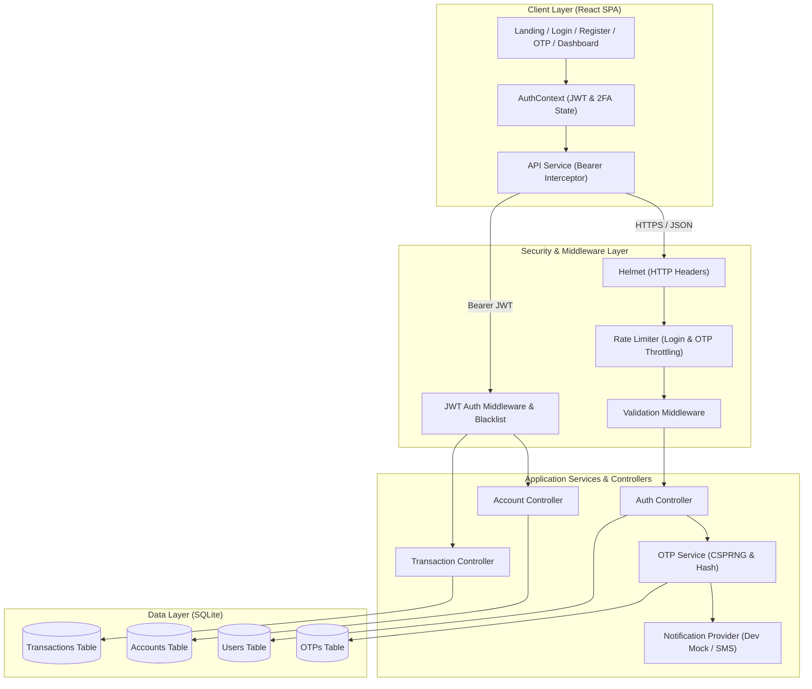
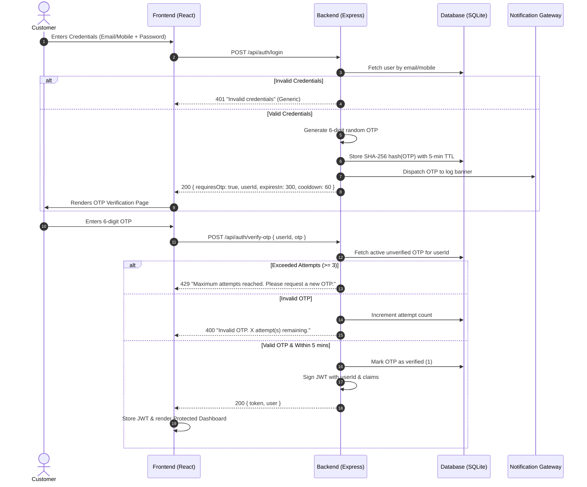

# Fortis Vault - Secure Banking Authentication and Account Dashboard

> **Full-Stack Internship Capstone Project**  
> *A security-first, full-stack online banking demonstration showcasing strong authentication, cryptographic two-factor OTP verification, session management, and a customer account dashboard.*

---

## 1. Project Objective

The primary objective of this internship project is to design and build a secure, full-stack internet banking platform demonstration named **Fortis Vault**. The system showcases modern enterprise security patterns, including salted password hashing, multi-stage Two-Factor Authentication (2FA) via One-Time Passwords (OTP), token-based authorization with cryptographic revocation, strict server-side validation, rate limiting, and customer dashboard interactions with simulated financial ledgers.

---

## 2. Problem Statement

Financial web portals are high-value targets for cyber threats such as credential stuffing, brute-force dictionary attacks, session hijacking, SQL injection, and unauthorized data enumeration. Traditional single-factor authentication (username + password) is insufficient for modern financial compliance. 

This project addresses these security challenges by implementing a layered defense mechanism:
1. Zero plain-text credential persistence.
2. Mandatory cryptographic 2FA before issuing authenticated session privileges.
3. Strict time-based expiry and attempt-throttling on verification codes.
4. Token blacklisting upon logout to prevent replay attacks.
5. Strict tenant isolation ensuring customers can only access their own financial records.

---

## 3. Key Features

- **User Registration**:
  - Validates full name, unique email, unique 10-digit mobile number, and passwords.
  - Enforces password complexity (min 8 chars, uppercase, lowercase, digit, special symbol).
  - Automatically provisions a simulated bank account (with masked account number and initial balance) and seeded transaction ledger.
- **Two-Factor Login**:
  - Multi-identifier lookup (email or mobile number).
  - Constant-time bcrypt password verification preventing timing attacks.
  - Protection against username enumeration via standardized generic error responses.
  - Brute-force rate limiting on IP and route levels.
- **Cryptographic OTP Two-Factor Authentication (2FA)**:
  - Cryptographically secure 6-digit random code generation (`crypto.randomInt`).
  - 5-minute strict time-to-live (TTL).
  - SHA-256 HMAC/salted hash storage in the database (plain OTP is never stored).
  - Maximum 3 verification attempts before automated lockout.
  - 60-second cooldown timer between resend requests.
  - Development mock provider with formatted console banner and dev evaluation pill.
- **Customer Banking Dashboard**:
  - Personalized welcome banner (`Welcome, [User Name]`).
  - Masked account number (`XXXX XXXX 1234`).
  - Available balance displayed in Indian Rupees (`₹50,000.00`).
  - Recent transactions table with formatted dates, descriptions, Credit/Debit badges, and transaction amounts.
  - Interactive transaction simulation modal (allows testing live balance changes with real-time feedback).
  - Customer security profile inspection view.
- **Secure Logout**:
  - Server-side JWT revocation via in-memory blacklist.
  - Client-side token and session cleanup.
  - Automatic redirection and route guard protection preventing back-navigation to protected views.

---

## 4. Technology Stack

| Layer | Technologies Used | Rationale |
| :--- | :--- | :--- |
| **Backend** | Node.js (v24), Express.js | High-concurrency event-driven architecture, modular routing, industry standard |
| **Database** | SQLite (`node:sqlite`) | Node 24 native in-process SQL engine, zero C++ compilation dependencies, ACID-compliant, parameterized SQL injection immunity |
| **Authentication & Crypto** | `bcryptjs`, `jsonwebtoken`, Node `crypto` | Salted hashing (cost 12), signed JWT tokens, SHA-256 OTP hashing, CSPRNG random generation |
| **Security Middleware** | `helmet`, `cors`, `express-rate-limit` | OWASP HTTP headers, restricted CORS policy, IP throttling against brute force |
| **Frontend** | React 18, Vite 6, React Router v6 | Fast single-page application (SPA), protected route wrappers, component reusability |
| **Icons & Design** | `lucide-react`, Custom Modern FinTech CSS | Professional dark-navy/slate banking theme, responsive layout, clear accessibility |
| **Testing** | Node.js Test Runner (`node:test`, `node:assert`) | Built-in zero-dependency testing, fast execution, automated integration test suites |

---

## 5. System Architecture



---

## 6. Database Schema

The database utilizes SQLite with foreign key enforcement and indexed lookups:

```sql
-- Users Table
CREATE TABLE users (
  id TEXT PRIMARY KEY,
  name TEXT NOT NULL,
  email TEXT NOT NULL UNIQUE,
  mobile TEXT NOT NULL UNIQUE,
  password_hash TEXT NOT NULL,
  created_at DATETIME DEFAULT CURRENT_TIMESTAMP,
  updated_at DATETIME DEFAULT CURRENT_TIMESTAMP
);

-- Accounts Table
CREATE TABLE accounts (
  id TEXT PRIMARY KEY,
  user_id TEXT NOT NULL UNIQUE,
  account_number TEXT NOT NULL UNIQUE,
  account_type TEXT NOT NULL DEFAULT 'Savings',
  balance REAL NOT NULL DEFAULT 50000.00,
  created_at DATETIME DEFAULT CURRENT_TIMESTAMP,
  FOREIGN KEY (user_id) REFERENCES users(id) ON DELETE CASCADE
);

-- Transactions Table
CREATE TABLE transactions (
  id TEXT PRIMARY KEY,
  account_id TEXT NOT NULL,
  type TEXT CHECK(type IN ('CREDIT', 'DEBIT')) NOT NULL,
  amount REAL NOT NULL,
  description TEXT NOT NULL,
  transaction_date DATETIME DEFAULT CURRENT_TIMESTAMP,
  FOREIGN KEY (account_id) REFERENCES accounts(id) ON DELETE CASCADE
);

-- OTP Table
CREATE TABLE otps (
  id TEXT PRIMARY KEY,
  user_id TEXT NOT NULL,
  otp_hash TEXT NOT NULL,
  expires_at DATETIME NOT NULL,
  attempts INTEGER NOT NULL DEFAULT 0,
  verified INTEGER NOT NULL DEFAULT 0,
  created_at DATETIME DEFAULT CURRENT_TIMESTAMP,
  FOREIGN KEY (user_id) REFERENCES users(id) ON DELETE CASCADE
);

-- Performance Indexes
CREATE INDEX idx_users_email ON users(email);
CREATE INDEX idx_users_mobile ON users(mobile);
CREATE INDEX idx_accounts_user_id ON accounts(user_id);
CREATE INDEX idx_transactions_account_id ON transactions(account_id);
CREATE INDEX idx_otps_user_id ON otps(user_id);
```

---

## 7. Authentication & OTP Verification Flow



---

## 8. REST API Documentation

### Base URL: `http://localhost:5000/api`

| Method | Endpoint | Auth Required | Description |
| :--- | :--- | :---: | :--- |
| `POST` | `/auth/register` | No | Registers user, hashes password, creates default account & seed transactions |
| `POST` | `/auth/login` | No | Validates credentials, creates & sends 6-digit 2FA OTP code |
| `POST` | `/auth/verify-otp` | No | Validates OTP hash, checks TTL/attempts, issues JWT session token |
| `POST` | `/auth/resend-otp` | No | Generates fresh OTP code respecting 60-second cooldown |
| `POST` | `/auth/logout` | **Yes (Bearer)** | Blacklists JWT session token and invalidates active session |
| `GET` | `/user/profile` | **Yes (Bearer)** | Fetches authenticated customer profile details |
| `GET` | `/account` | **Yes (Bearer)** | Fetches customer account info with masked account number |
| `GET` | `/account/balance` | **Yes (Bearer)** | Fetches real-time available balance |
| `GET` | `/transactions` | **Yes (Bearer)** | Fetches transaction history for customer's account |
| `POST` | `/transactions/simulate` | **Yes (Bearer)** | Simulates a deposit or transfer, updating balance dynamically |
| `GET` | `/health` | No | Health check reporting service status and API version |

---

## 9. Security Measures Implemented

1. **Password Security**:
   - Encrypted with `bcryptjs` using 12 salt rounds.
   - Enforced password policy: minimum 8 characters, at least 1 uppercase, 1 lowercase, 1 number, and 1 special symbol.
   - Plain passwords are never saved, logged, or returned in responses.
2. **2FA Cryptographic Security**:
   - Random 6-digit numbers generated via Node's Cryptographically Secure Pseudorandom Number Generator (`crypto.randomInt`).
   - OTP codes are hashed with SHA-256 + server secret before storage.
   - Enforced 5-minute expiration timestamp.
   - Enforced 3-attempt limit with lockout.
   - OTP records are immediately invalidated upon successful verification.
3. **Defense Against Enumeration**:
   - Generic error messages for login failures (`"Invalid credentials. Please verify your email/mobile and password."`) preventing user discovery.
4. **Rate Limiting & Abuse Prevention**:
   - Login rate limiter: 10 attempts per 15 minutes per IP.
   - OTP request rate limiter: 15 requests per 10 minutes per IP.
   - General API limiter: 300 requests per 15 minutes.
5. **Session Security & Invalidation**:
   - Signed JSON Web Tokens with expiry.
   - In-memory token revocation blacklist on logout.
   - Protected client-side React routes (`ProtectedRoute`) that redirect unauthenticated visitors.
6. **Data Isolation & Injection Prevention**:
   - Parameterized SQL statements on all database queries (`db.prepare('...').run(...)`).
   - All account and transaction queries strictly scope to `req.user.id`.
7. **HTTP Security**:
   - `helmet` security headers (X-Content-Type-Options, X-Frame-Options, HSTS, etc.).
   - Explicit CORS configuration.
   - Request payload body size capped at 10KB to prevent memory exhaustion attacks.

---

## 10. Folder Structure

```
Hnnoix/
├── backend/
│   ├── config/
│   │   ├── db.js                     # SQLite connection, tables & indexes
│   │   └── env.js                    # Environment configuration loader
│   ├── controllers/
│   │   ├── authController.js         # Register, Login, 2FA OTP, Logout
│   │   ├── userController.js         # User profile retrieval
│   │   ├── accountController.js      # Account details & balance
│   │   └── transactionController.js  # Transaction ledger & simulation
│   ├── middleware/
│   │   ├── authMiddleware.js         # JWT verification & blacklist check
│   │   ├── errorHandler.js           # Centralized safe error handler
│   │   ├── rateLimiter.js            # IP-based rate limiting rules
│   │   └── validationMiddleware.js   # Server-side input validators
│   ├── models/
│   │   ├── accountModel.js           # Accounts data queries
│   │   ├── otpModel.js               # OTP tracking & attempt counters
│   │   ├── transactionModel.js       # Transaction queries & seeders
│   │   └── userModel.js              # User CRUD & lookup
│   ├── routes/
│   │   ├── accountRoutes.js          # /api/account endpoints
│   │   ├── authRoutes.js             # /api/auth endpoints
│   │   ├── transactionRoutes.js      # /api/transactions endpoints
│   │   └── userRoutes.js             # /api/user endpoints
│   ├── services/
│   │   ├── authService.js            # Bcrypt hashing & JWT signing
│   │   ├── notificationService.js    # Pluggable notification gateway
│   │   └── otpService.js             # OTP lifecycle & verification logic
│   ├── tests/
│   │   ├── auth.test.js              # Registration & login tests
│   │   ├── dashboard.test.js         # Account, isolation & logout tests
│   │   ├── e2eVerification.js        # Full flow automated integration
│   │   ├── otp.test.js               # OTP expiry, lockout & reuse tests
│   │   └── testHelper.js             # Ephemeral server test utilities
│   ├── utils/
│   │   ├── helpers.js                # Masking, randoms & currency format
│   │   └── logger.js                 # Redacted logging & OTP banners
│   ├── .env                          # Local environment variables
│   ├── .env.example                  # Environment configuration template
│   ├── database.sqlite               # Local database file
│   ├── package.json                  # Backend dependencies & test scripts
│   └── server.js                     # Express entry point & static SPA host
├── frontend/
│   ├── public/                       # Static public assets
│   ├── src/
│   │   ├── components/
│   │   │   ├── AlertNotification.jsx # Dismissible alerts
│   │   │   ├── Modal.jsx             # Transaction simulator modal
│   │   │   ├── Navbar.jsx            # Banking top navigation
│   │   │   ├── OtpInput.jsx          # 6-digit segmented OTP input
│   │   │   ├── Sidebar.jsx           # Banking sidebar navigation
│   │   │   ├── StatCard.jsx          # Metric cards
│   │   │   └── TransactionTable.jsx  # Filterable transaction table
│   │   ├── context/
│   │   │   └── AuthContext.jsx       # Global auth & 2FA state
│   │   ├── pages/
│   │   │   ├── DashboardPage.jsx     # Authenticated banking dashboard
│   │   │   ├── LoginPage.jsx         # Customer login page
│   │   │   ├── OtpVerificationPage.jsx# Two-factor verification page
│   │   │   └── RegisterPage.jsx      # Customer registration page
│   │   ├── services/
│   │   │   └── api.js                # Frontend API client
│   │   ├── styles/
│   │   │   └── index.css             # FinTech design system styles
│   │   ├── App.jsx                   # Router & route guards
│   │   └── main.jsx                  # React DOM entry point
│   ├── dist/                         # Compiled production bundle
│   ├── index.html                    # HTML entry point with fonts
│   ├── package.json                  # Frontend dependencies
│   └── vite.config.js                # Vite build & proxy config
├── package.json                      # Root orchestration scripts
└── README.md                         # Complete project documentation
```

---

## 11. Environment Variables

The project includes `.env` and `.env.example` in the `backend/` directory:

```env
PORT=5000
NODE_ENV=development
JWT_SECRET=super_secret_jwt_key_replace_in_production_banking_demo_2026
JWT_EXPIRES_IN=1h
OTP_EXPIRY_MINUTES=5
OTP_MAX_ATTEMPTS=3
OTP_RESEND_COOLDOWN_SECONDS=60
DB_FILE=database.sqlite
CORS_ORIGIN=http://localhost:5173
```

---

## 12. Setup and Execution Instructions

### Prerequisites
- Node.js (version 22+ or 24+ recommended)
- npm (version 10+)

### Quick Start (Single Command / Unified Production Mode)

The backend Express server is pre-configured to host both the API and the compiled React SPA:

```bash
# In the backend directory:
cd backend
npm install
npm start
```

Open your browser to: **`http://localhost:5000`**

---

### Development Mode (Concurrent Vite + Express)

For hot module replacement (HMR) during frontend development:

**Terminal 1 (Backend):**
```bash
cd backend
npm install
npm run dev
```
*Backend runs on `http://localhost:5000`*

**Terminal 2 (Frontend):**
```bash
cd frontend
npm install
npm run dev
```
*Frontend runs on `http://localhost:5173` with automated API proxying to port 5000.*

---

## 13. How to Run Automated Tests

The project includes 28 automated integration tests covering the entire banking security lifecycle.

```bash
cd backend
npm test
```

### Full End-to-End Verification Flow

To run the complete automated end-to-end integration test:

```bash
cd backend
node tests/e2eVerification.js
```

---

## 14. Demo Credentials & Test Users

You can register any new user directly through the UI, or use the following pre-configured demonstration scenarios:

### Test Account:
- **Email**: `aarav.sharma@example.com`
- **Mobile Number**: `9876543210`
- **Password**: `SecurePass@2026`
- **Account Type**: `Savings`
- **Initial Balance**: `₹50,000.00`
- **2FA OTP**: Displayed in the terminal console banner and in the green **Dev Demo OTP** badge on the verification screen.

---

## 15. Screenshots / Visual Progression

| View | Description |
| :--- | :--- |
| **Login Page** | Secure customer portal with email/mobile login, password toggle, and financial security badges. |
| **Registration Page** | Field validation, real-time password policy checklist, and password match indicator. |
| **2FA Verification** | 6-digit segmented OTP input, 5-minute countdown clock, resend cooldown timer, and mock banner. |
| **Dashboard** | Personalized greeting, masked account (`XXXX XXXX 1234`), balance (`₹50,000.00`), transaction ledger, and profile summary. |
| **Simulated Transfer** | Interactive modal for executing debits and credits with instant balance recalculation. |

---

## 16. Future Enhancements

1. **SMS/Email Gateway Integration**: Direct connector modules for Twilio SMS and SendGrid Email.
2. **Biometric WebAuthn**: Support for Passkeys and FIDO2 fingerprint/face recognition.
3. **Audit Log Export**: Downloadable monthly PDF bank statements with digital signatures.
4. **Beneficiary Management**: Address book with beneficiary cooling periods before high-value transfers.

---

## 17. Internship Learning Outcomes

Completing this project provided rigorous practical experience in enterprise-grade software engineering:

- **Full-Stack Development**: Architected a decoupled, production-grade system with Express.js REST APIs and React 18 SPA.
- **REST API Development**: Designed RESTful routes following clean controller-service-model separation with proper HTTP status codes.
- **Database Management**: Configured SQLite schema design, foreign key constraints, indexes, and parameterized queries using native Node 24 capabilities.
- **Authentication**: Implemented multi-tier authentication with stateful credential verification and stateless signed JWT issuance.
- **OTP-based 2FA**: Engineered a resilient two-factor verification cycle enforcing time-to-live expiration, cryptographically secure random generation, salted hashing, and attempt-limit lockouts.
- **Password Security**: Applied bcrypt hashing with cost factor 12 and robust client-and-server validation policies.
- **API Security**: Implemented defense-in-depth using Helmet headers, CORS policies, rate limiting, and session blacklisting.
- **Frontend-Backend Integration**: Connected React hooks and context with backend services, including loading states, error handlers, and token persistence.
- **Testing & Debugging**: Authored automated test suites with 28 passing unit and integration tests verifying all edge cases.
